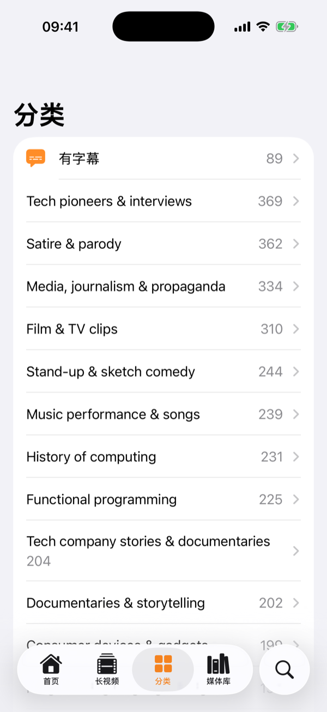
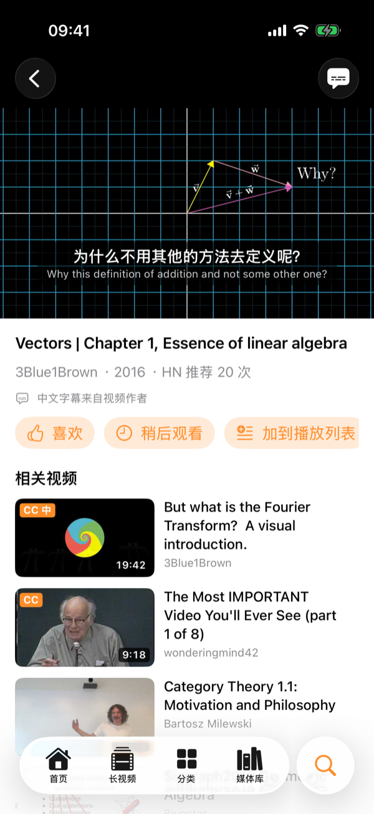

<!-- README_SYNC: source=5a9a029; updated=2026-11-02 -->
<p align="center">
  简体中文 · <a href="./README_EN.md">English</a>
</p>

# HackerTube iOS

在 iPhone 上看 [HackerTube](https://hackertube.org/) 收录的 6454 个技术与教育视频，**每个视频都配中英双语字幕**。不用登录，所有记录都只存在手机里。

如果它对你有用，欢迎点一个 [⭐ Star](https://github.com/Shaojie66/HackerTube-iOS/stargazers)，方便以后回来找，也让更多想用中文看 3Blue1Brown、Computerphile 这类视频的人发现它。

[](https://github.com/Shaojie66/HackerTube-iOS/stargazers)
[](#自己编译安装)
[](project.yml)
[](LICENSE)
[](https://github.com/Shaojie66/HackerTube-iOS/issues)
[](https://github.com/Shaojie66/HackerTube-iOS/commits/main)

> 这是个人做的非官方客户端，和 HackerTube 网站及其作者没有关联。视频目录来自网站公开的数据导出包。

| 首页 | 分类 | 播放页：中英双字幕 |
|---|---|---|
|  |  |  |

## 它解决什么问题

HackerTube 是 Andrej Karpathy 的周末项目：从 Hacker News 二十年的评论里，筛出被反复推荐的 YouTube 视频。内容很好，但几乎全是英文，网页上也没有中文字幕。

| | 直接在 YouTube 看 | HackerTube iOS |
|---|---|---|
| 找好视频 | 靠算法推荐 | 6454 个被 HN 反复推荐的视频，150 个分类 |
| 中文字幕 | 多数视频没有，自动翻译要逐个开 | 中英两行同时显示，作者传了中文字幕就直接用 |
| 账号 | 需要登录才能记历史 | 不需要账号，喜欢、历史、稍后观看都存在本机 |

## 功能

- **浏览**：首页（按你本地喜欢和看过的分类、频道推荐）、长视频、分类、搜索，以及只看已备好字幕视频的「有字幕」分类。
- **媒体库**：喜欢、历史记录（带续播位置）、稍后观看、播放列表，长按可重命名或删除。
- **播放器**：YouTube 官方内嵌播放器，上面叠一层 App 自己画的字幕，支持横屏。字幕可切换中英双语、仅中文、仅英文或关闭，字号可调。
- **缩略图**：和原站一样用视频中段的画面；已备好字幕的视频标 `CC`，带作者中文字幕的标 `CC 中`。

## 双语字幕怎么来

1. **英文**：`tools/fetch_subtitles.py` 用 yt-dlp 批量下载 YouTube 字幕，人工字幕优先，其次自动字幕，可选用 Whisper 转写；合并成整句后存成 `subtitles/<视频ID>.en.json`。仓库里还没有的视频，App 会试着直接读 YouTube 字幕兜底（非公开接口，可能失效）。
2. **中文**：视频作者上传了中文字幕时，`tools/fetch_zh_subtitles.py` 把它存成 `subtitles/<视频ID>.zh.json`，App 直接显示，不再翻译。其他视频由 iOS 18 自带的 [Translation 框架](https://developer.apple.com/documentation/translation)在手机上翻译，免费、不需要 API Key，从当前播放位置先翻，翻完会缓存。
3. **下载**：App 按 jsDelivr → fastly → GitHub raw 的顺序取字幕和目录，前一个连不上就换下一个，大陆网络下也能用。

**当前进度（2026-11-02）**：6454 个视频里已有 89 个英文字幕、6 个作者中文字幕。全量英文字幕还在 Mac 上慢慢跑，YouTube 限流时会自动暂停。

## 自己编译安装

暂时没有上架 App Store 或 TestFlight，需要用 Xcode 自己装到手机上。

需要 macOS、Xcode 16 或更新版本、iOS 18 或更新的 iPhone / iPad。

```bash
brew install xcodegen
xcodegen
open HackerTube.xcodeproj
```

在 Xcode 里选你自己的签名 Team，连上手机运行即可。用免费的个人 Apple ID 签名时，App 7 天后会失效，需要重新安装。

> 模拟器上系统翻译可能下载不了语言模型，中文翻译请用真机测试。

### 测试

在 Xcode 里选 `HackerTube` scheme，按 ⌘U 运行 UI 测试（`HackerTubeUITests/FeatureTests.swift`），覆盖首页分类、搜索、播放器与媒体库、长按菜单和续播。最近一次运行（2026-11-02）除续播位置外都通过了。

## 更新数据

依次是：视频目录（网站导出包 hackertube.org/data 不含时长和发布日期，先从网站补齐，再复制一份内置进 App 供离线使用）、英文字幕（可中断续跑）、作者上传的中文字幕。中文字幕不要和英文全量任务同时大量跑，同一个 IP 更容易被限流。

```bash
python3 tools/fetch_site_meta.py --out /tmp/ht/youtube_meta.json
python3 tools/build_catalog.py /tmp/ht/videos.jsonl --meta /tmp/ht/youtube_meta.json --out data/catalog.json
cp data/catalog.json HackerTube/Resources/catalog.json

pip install yt-dlp
python3 tools/fetch_subtitles.py data/catalog.json --out subtitles

python3 tools/fetch_zh_subtitles.py data/catalog.json --out subtitles
```

长时间跑全量英文字幕可以用 `tools/run_subtitles.sh`：每 300 个提交推送一次，视频之间随机等待 15–40 秒，中断后重新执行即可续跑。

## 项目结构

| | |
|---|---|
| `HackerTube/App/` | 入口、标签页、配置（仓库名、下载地址） |
| `HackerTube/Models/` | Video、字幕数据结构 |
| `HackerTube/Services/` | 视频目录、本地媒体库、字幕下载与缓存 |
| `HackerTube/Views/` | 首页、分类、媒体库、播放器（YouTube 内嵌 + 双语字幕 + 本机翻译） |
| `HackerTubeUITests/` | UI 测试 |
| `tools/` | 目录转换、元数据补齐、字幕批量下载脚本 |
| `data/` | 视频目录（App 从 CDN 读取） |
| `subtitles/` | 英文与中文字幕（App 从 CDN 读取） |

## 致谢与许可

- 视频筛选和数据来自 Andrej Karpathy 的 [HackerTube](https://hackertube.org/)。
- 视频本身由 YouTube 内嵌播放器播放，版权归各自作者。

代码以 [MIT 许可证](LICENSE) 发布。`data/` 里的视频目录来自 HackerTube 的公开数据，`subtitles/` 里的字幕来自各视频在 YouTube 上的字幕，这两部分不属于 MIT 授权，权利归原作者。

---

觉得有用的话，点个 [⭐ Star](https://github.com/Shaojie66/HackerTube-iOS/stargazers)；遇到问题或有想法，欢迎[提 Issue](https://github.com/Shaojie66/HackerTube-iOS/issues)。
