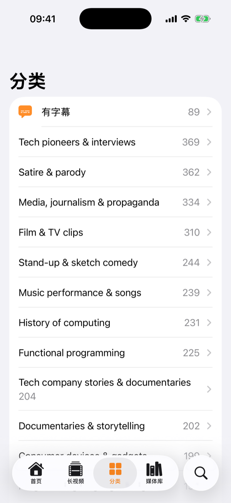
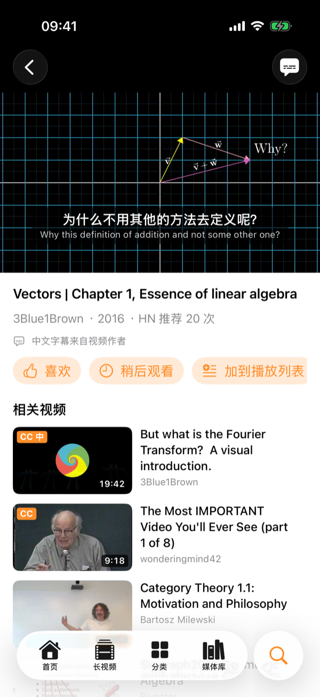

<!-- README_SYNC: source=5a9a029; updated=2026-11-02 -->
<p align="center">
  <a href="./README.md">简体中文</a> · English
</p>

# HackerTube iOS

Watch the 6,454 technical and educational videos curated by
[HackerTube](https://hackertube.org/) on your iPhone, **with Chinese and English
subtitles shown together**. No sign-in; everything you do stays on the device.

If it's useful to you, a [⭐ Star](https://github.com/Shaojie66/HackerTube-iOS/stargazers)
bookmarks it and helps other people who want to watch 3Blue1Brown or
Computerphile in Chinese find it.

[](https://github.com/Shaojie66/HackerTube-iOS/stargazers)
[](#build-and-install)
[](project.yml)
[](LICENSE)
[](https://github.com/Shaojie66/HackerTube-iOS/issues)
[](https://github.com/Shaojie66/HackerTube-iOS/commits/main)

> An unofficial, personal client. It is not affiliated with the HackerTube site
> or its author. The video catalogue comes from the site's public data export.

| Home | Categories | Player with bilingual subtitles |
|---|---|---|
|  |  |  |

## Why

HackerTube is a weekend project by Andrej Karpathy: it mines twenty years of
Hacker News comments for the YouTube videos people keep recommending. The
picks are great, but almost all of them are in English, and the site has no
Chinese subtitles.

| | Plain YouTube | HackerTube iOS |
|---|---|---|
| Finding good videos | Whatever the algorithm suggests | 6,454 videos HN keeps recommending, in 150 categories |
| Chinese subtitles | Missing on most videos; auto-translate is per video | Two lines, Chinese over English; the creator's own Chinese track is used when there is one |
| Account | Sign in to keep history | None. Likes, history and Watch later live on the device |

## Features

- **Browse**: Home (ranked by the categories and channels you liked or watched,
  on device), Longs, Categories, Search, and a "has subtitles" category that
  only lists videos whose subtitles are ready.
- **Library**: Liked, History (with resume position), Watch later and
  playlists; long-press to rename or delete.
- **Player**: the official YouTube embedded player with the app's own
  subtitle layer on top, in portrait or landscape. Switch between bilingual,
  Chinese only, English only or off, and change the text size.
- **Thumbnails**: a frame from the middle of the video, as on the site. Videos
  with subtitles ready are marked `CC`; those with the creator's Chinese track
  are marked `CC 中`.

## Where the subtitles come from

1. **English**: `tools/fetch_subtitles.py` downloads YouTube subtitles with
   yt-dlp (uploaded first, then auto-generated, optionally Whisper), merges them
   into whole sentences and saves `subtitles/<videoID>.en.json`. For a video
   not in the repo yet, the app tries YouTube's subtitles directly as a
   fallback (an unofficial endpoint that may stop working).
2. **Chinese**: when the creator uploaded a Chinese track,
   `tools/fetch_zh_subtitles.py` saves it as `subtitles/<videoID>.zh.json` and
   the app shows it as is. Everything else is translated on the phone by iOS
   18's [Translation framework](https://developer.apple.com/documentation/translation):
   free, no API key, starting from where you are in the video, then cached.
3. **Download**: the app fetches subtitles and the catalogue from jsDelivr,
   then fastly, then GitHub raw, moving on when one is unreachable, so it works
   on mainland China networks too.

**Progress (2026-11-02)**: of 6,454 videos, 89 have English subtitles and 6
have the creator's Chinese track. The full English run is still going on a Mac
and pauses on its own when YouTube rate-limits it.

## Build and install

It is not on the App Store or TestFlight yet; install it from Xcode.

You need macOS, Xcode 16 or later, and an iPhone or iPad on iOS 18 or later.

```bash
brew install xcodegen
xcodegen
open HackerTube.xcodeproj
```

Pick your own signing Team in Xcode, connect the device and run. With a free
personal Apple ID the app expires after 7 days and has to be installed again.

> On the simulator the system translator may fail to download its language
> model; test Chinese translation on a real device.

### Test

Select the `HackerTube` scheme in Xcode and press ⌘U to run the UI tests
(`HackerTubeUITests/FeatureTests.swift`). They cover Home categories, search,
the player and library, the long-press menu and resume. In the last run
(2026-11-02) everything passed except the resume position.

## Updating the data

In order: the catalogue (the site's export at hackertube.org/data has no durations or publish dates, so fetch those first, then copy it into the app for offline use), English subtitles (safe to stop and resume), and creator-uploaded Chinese subtitles. Don't run the Chinese script alongside a full English run: one IP gets rate-limited faster.

```bash
python3 tools/fetch_site_meta.py --out /tmp/ht/youtube_meta.json
python3 tools/build_catalog.py /tmp/ht/videos.jsonl --meta /tmp/ht/youtube_meta.json --out data/catalog.json
cp data/catalog.json HackerTube/Resources/catalog.json

pip install yt-dlp
python3 tools/fetch_subtitles.py data/catalog.json --out subtitles

python3 tools/fetch_zh_subtitles.py data/catalog.json --out subtitles
```

For a long full English run, use `tools/run_subtitles.sh`: it commits and
pushes every 300 videos, waits a random 15–40 s between videos, and resumes
when you run it again.

## Layout

| | |
|---|---|
| `HackerTube/App/` | entry point, tabs, config (repo name, download mirrors) |
| `HackerTube/Models/` | Video and subtitle types |
| `HackerTube/Services/` | catalogue, on-device library, subtitle download and cache |
| `HackerTube/Views/` | Home, Categories, Library, Player (YouTube embed + bilingual subtitles + on-device translation) |
| `HackerTubeUITests/` | UI tests |
| `tools/` | catalogue conversion, metadata, bulk subtitle scripts |
| `data/` | video catalogue (read by the app over CDN) |
| `subtitles/` | English and Chinese subtitles (read by the app over CDN) |

## Credits and licence

- Video selection and data: [HackerTube](https://hackertube.org/) by Andrej Karpathy.
- Videos play in YouTube's embedded player and belong to their creators.

The code is released under the [MIT License](LICENSE). The catalogue in `data/` comes from HackerTube's public data, and the subtitles in `subtitles/` come from each video's YouTube captions; neither is covered by the MIT License, and both belong to their original owners.

---

If it saved you time, [⭐ Star it](https://github.com/Shaojie66/HackerTube-iOS/stargazers);
for bugs or ideas, [open an issue](https://github.com/Shaojie66/HackerTube-iOS/issues).
